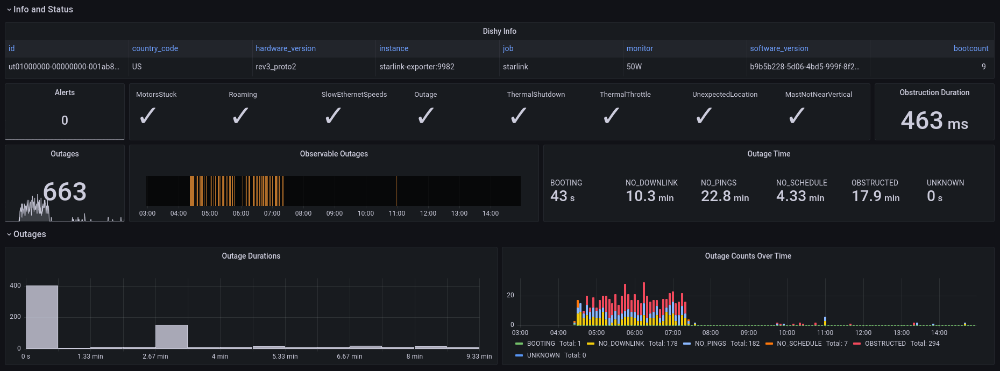
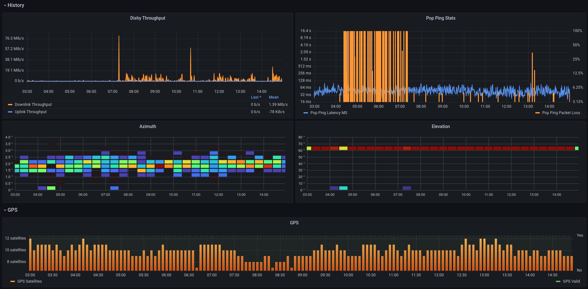
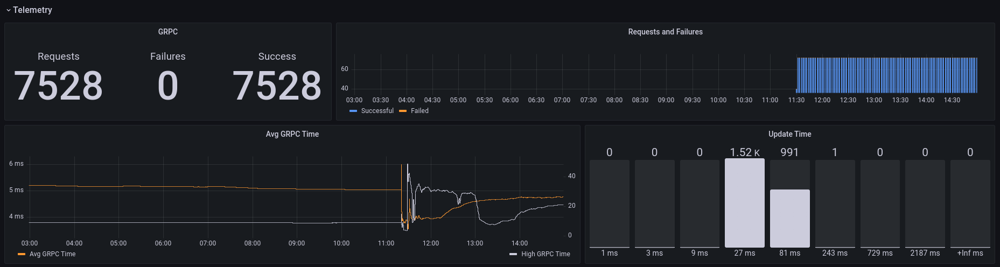

# starlink-exporter

Prometheus exporter for SpaceX Starlink Dishy. Collects metrics via gRPC from the Dishy device and exposes them on a Prometheus HTTP endpoint.

## Installation

### Build from source

```bash
go build -o starlink-exporter ./cmd/starlink-exporter
```

### Docker

```bash
docker build -t starlink-exporter .
docker run -p 9982:9982 starlink-exporter
```

This runs alongside Prometheus in k8s or as part of a docker-compose. No special permissions or volumes required.

## Usage

```bash
./starlink-exporter [flags]
```

### Flags

| Flag | Default | Description |
|------|---------|-------------|
| `--host` | `192.168.100.1:9200` | IP and port of Dishy gRPC endpoint |
| `--promAddr` | `0.0.0.0:9982` | Listen address and port for Prometheus /metrics |
| `--interval` | `30s` | Update interval (Go duration, e.g. `1m30s`) |
| `--logLevel` | `info` | Logging level (`error`, `warn`, `info`, `debug`, `trace`) |
| `--debug` | `false` | Dump all Dishy API responses as JSON |

### Example

```bash
./starlink-exporter --host 192.168.100.1:9200 --promAddr 0.0.0.0:9982 --interval 30s --logLevel info
```

## Metrics

All metrics use the `starlink_` prefix.

### Exporter Metrics (`starlink_exporter_*`)

| Metric | Type | Description |
|--------|------|-------------|
| `starlink_exporter_grpc_time` | Histogram | Time spent interacting with Dishy gRPC |
| `starlink_exporter_update_time` | Histogram | Total time to pull all data from Dishy |
| `starlink_exporter_updates` | Counter | Number of Dishy updates |
| `starlink_exporter_failures` | Counter | Number of Dishy request failures |
| `starlink_exporter_requests` | Counter | Number of Dishy requests |
| `starlink_exporter_failing` | Gauge | Boolean indicator if requests to Dishy are failing |

### Device Info Metrics (`starlink_dishy_*`)

| Metric | Type | Labels | Description |
|--------|------|--------|-------------|
| `starlink_dishy_bootcount` | Gauge | `id`, `hardware_version`, `software_version`, `manufactured_version`, `country_code` | Dishy boot count |
| `starlink_dishy_uptime_s` | Gauge | | Uptime of Dishy in seconds |

### GPS Metrics

| Metric | Type | Description |
|--------|------|-------------|
| `starlink_dishy_gps_valid` | Gauge | Boolean indicator for GPS valid |
| `starlink_dishy_gps_sats` | Gauge | Number of available GPS satellites |

### Alert & Obstruction Metrics

| Metric | Type | Labels | Description |
|--------|------|--------|-------------|
| `starlink_dishy_alert_status` | Gauge | `alert` | Status of individual alerts |
| `starlink_dishy_alerts` | Gauge | | Number of current alerts |
| `starlink_dishy_obstructed` | Gauge | | Boolean, dishy is obstructed |
| `starlink_dishy_fraction_obstructed` | Gauge | | Percent obstructed |
| `starlink_dishy_avg_prolonged_obstruction_duration_s` | Gauge | | Average duration of obstruction |
| `starlink_dishy_time_obstructed_s` | Gauge | | Total seconds obstructed |
| `starlink_dishy_obstruction_interval_s` | Gauge | | Average interval between obstructions |
| `starlink_dishy_obstruction_valid_s` | Gauge | | Seconds of valid obstruction data |
| `starlink_dishy_outage` | Gauge | | Boolean, current Dishy outage status |

### Throughput & Latency Metrics

| Metric | Type | Description |
|--------|------|-------------|
| `starlink_dishy_pop_ping_drop_rate` | Gauge | Current PoP ping drop rate |
| `starlink_dishy_pop_ping_latency_ms` | Gauge | Current PoP ping latency in milliseconds |
| `starlink_dishy_downlink_throughput_bps` | Gauge | Current downlink throughput in bits per second |
| `starlink_dishy_uplink_throughput_bps` | Gauge | Current uplink throughput in bits per second |

### Orientation Metrics

| Metric | Type | Description |
|--------|------|-------------|
| `starlink_dishy_boresight_azimuth_deg` | Gauge | Boresight azimuth in degrees |
| `starlink_dishy_boresight_elevation_deg` | Gauge | Boresight elevation in degrees |
| `starlink_dishy_tilt_angle_deg` | Gauge | Dish tilt angle in degrees |
| `starlink_dishy_attitude_uncertainty_deg` | Gauge | Attitude/alignment uncertainty in degrees |
| `starlink_dishy_eth_speed_mbps` | Gauge | Ethernet speed in Mbps |

### Outage Metrics

| Metric | Type | Labels | Description |
|--------|------|--------|-------------|
| `starlink_dishy_outage_times` | Histogram | | Histogram of outage durations |
| `starlink_dishy_outages` | Gauge | `cause` | Number of recent outages by cause |
| `starlink_dishy_outage_duration_sec_avg` | Gauge | `cause` | Average outage duration by cause |
| `starlink_dishy_outage_duration_sec_sum` | Gauge | `cause` | Total outage duration by cause |

### Status Metrics

| Metric | Type | Labels | Description |
|--------|------|--------|-------------|
| `starlink_dishy_stow_requested` | Gauge | | Boolean, 1 if stow requested |
| `starlink_dishy_snr_above_noise_floor` | Gauge | | Boolean, 1 if SNR is healthy |
| `starlink_dishy_snr_persistently_low` | Gauge | | Boolean, 1 if SNR is persistently low |
| `starlink_dishy_software_update_state` | Gauge | `state` | Software update state |
| `starlink_dishy_software_update_progress` | Gauge | | Software update progress (0.0 to 1.0) |
| `starlink_dishy_seconds_to_first_nonempty_slot` | Gauge | | Time to next non-empty slot |
| `starlink_dishy_is_cell_disabled` | Gauge | | Boolean, 1 if cell is disabled |
| `starlink_dishy_mobility_class` | Gauge | `class` | Mobility class |

## Prometheus Alerts

Sample prometheus alerts have been provided in [prom_alerts.yml](prom_alerts.yml).

You will want to tweak at minimum the high latency and high packet loss values for your deployment and needs.

## Grafana

A dashboard is provided for use with this exporter: [contrib/grafana/starlink-dashboard.json](contrib/grafana/starlink-dashboard.json)




